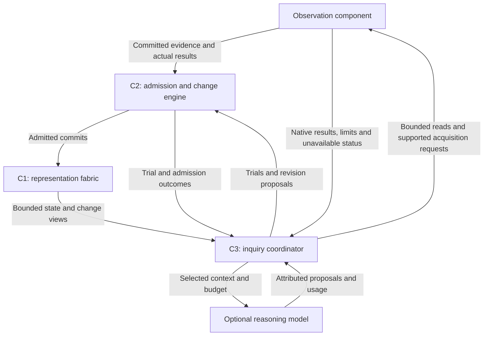

# EDI substrate blueprint

Date: 2026-10-19. Status: design proposal for owner review; architecture REVISE. Product verification: NOT RUN. This is the next design baseline, not permission to implement or benchmark.

Entry and functional history: [SUBSTRATE_PLAN.md](SUBSTRATE_PLAN.md). Requirement authority: [REQUIREMENTS.json](REQUIREMENTS.json). Systems coverage: [MEADOWS_REVIEW.md](MEADOWS_REVIEW.md). Observation integration: [OBSERVATION_SUBSTRATE.md](../integration/OBSERVATION_SUBSTRATE.md). Concrete challenge: [BUDWORM_CHALLENGE.md](BUDWORM_CHALLENGE.md).

## Purpose and boundary

The substrate is one component with a capability: host persistent, revisable representations whose organization and interactions can develop through experience. Its six functions remain form/compose, connect/interact, evolve/reorganize, ground/preserve alternatives, enable inquiry/comparison, and persist/bound resources. Functions are not six mandated services. The ten-capability catalogue is not a physical component stack.

Observation owns acquired native records, operational origin/assertion history and evidence availability. Substrate owns representations, interpretation, candidate mechanisms and their histories. A representation can concern an element, process, composition, relationship or a relationship among relationships. Its handle is not proof of a physical object's identity.

Semantic neutrality means no mandatory domain labels or supplied ecological/economic ontology. It cannot mean zero assumptions: addressability, structural primitives, clocks, change rules, search families and inquiry objectives are engineered priors. Imported encoders and LLM training knowledge remain attributed. Preserve unfamiliar native content without pretending it has been understood.

No finite design can guarantee a complete representation of every real-world relationship or nonlinearity. The useful aim is revisable, evidence-grounded models at declared boundaries, scales and purposes, with explicit unknowns and reasons to expand those boundaries. Hosting a mechanism, discovering it, identifying it from available evidence and validating its consequences are separate capabilities.

## Smallest proposed architecture

Start with one deployable process and three logical parts. Storage/backend decisions follow declared semantics and measured requirements; there is no service per function.

| Part | Owns | Why it is necessary |
| --- | --- | --- |
| SUB-C1 Representation fabric | Sole durable substrate state, revisions, dependencies, evidence references, trial namespaces and bounded read views | Long-lived, correctable organization cannot depend on a model context window or competing state logs. |
| SUB-C2 Interaction and change engine | Admission, authority/version checks, bounded rule/trial execution and submission of admitted commits to C1 | Interaction and reorganization need consistent changes without letting hypotheses overwrite evidence or stale writers overwrite experience. |
| SUB-C3 Inquiry coordinator | Budgeted inspection, alternatives, conditional predictions, evidence requests, outcome comparison and selection/cost lineage | A host alone does not explain how questions arise, discriminate mechanisms or cause justified revision. |

This diagram summarizes high-risk flows, not the full operation inventory. C3 can query C1 but cannot directly mutate it. New acquired evidence is admitted by C2 before C1 materialization. C1 owns durable commit storage; C2 owns the admission decision. No second durable mutation authority is created.

## Representation and state

Propose a versioned addressable record-and-relation host as the initial logical primitive. It is a declared structural prior, not a proof that graphs are universal or optimal. Native arrays, images, audio, fields, symbolic structures and temporal views remain addressable by reference/selector. Graph-like links organize references; they need not turn every payload into nodes, prose or a single embedding.

Keep the following concerns separable and extensible rather than placing everything in a mandatory flat envelope:

| Concern | Required expressiveness |
| --- | --- |
| Continuity | Scoped handle, revision, lineage, supersession, valid/known time and explicit unknowns. |
| Content and state | Native and derived views; state values with context, units when known, missingness and method/model versions. |
| Composition | Ordered/unordered, nested/overlapping parts, reusable substructures, selectors and declared compression loss. |
| Relationships | Typed or initially unresolved, multi-party, relationship-to-relationship, conditional dependencies and opposing evidence. |
| Interfaces and dynamics | Named boundary/participants, exchange direction, unknown/proposed response sign/strength, delay, memory and versioned update rules. |
| Epistemic grounding | Supporting/opposing evidence, assumptions, uncertainty sets or qualitative uncertainty, alternatives and dependencies. |

Not every record needs every concern populated. Unknown is a valid state. A universal scalar confidence, mandatory causal interpretation, fixed hierarchy and full connection mesh are unnecessary. Similarity, containment and co-occurrence need not be causal input/output paths. Software ports and represented world interfaces are distinct.

Distinguish three state domains: actual substrate execution state; observations/inferred world state; and candidate prediction/simulation state. A trial cannot silently become an acquired observation. Do not impose physical conservation on information copying, or assign intention to every process. Constraints and inferred purposes need context and provenance.

Larger organization may contain shared substructures and disconnected regions. Preserve alternative boundaries and rivals; shared evidence does not justify merging identities. Support split, combine, retract, refine and context changes with revision history. No forced single giant representation.

## Proposed specifications

All six specifications below are proposed and unimplemented. Detailed serialization, operation algebra, error enums and transaction fixtures remain contract work. Requirement/case allocations are in the catalogue.

| Spec | Contract and acceptance obligation |
| --- | --- |
| SUB-C1-S01 Native representation and grounding | Create addressable native/derived structures with scoped identity, composition, explicit unknowns and evidence lineage. A mixed-modality fixture must recover native selectors and distinguish inference, imported interpretation and actual state. |
| SUB-C1-S02 Durable revisions and bounded views | Atomically store admitted changes, affected dependencies, applied request/occurrence IDs and progress checkpoint within the declared commit unit. Bounded reads return revision, pagination and unavailable status. Restore/replay must preserve prior as-of views or explicitly report what cannot be recovered. |
| SUB-C2-S01 Admission and commit coordination | Validate authority, expected versions, idempotency, dependencies and resource bounds before asking C1 to commit. Reject stale/conflicting/unsupported changes without partial silent mutation. Acknowledge consumed evidence only after durable state/checkpoint consistency. |
| SUB-C2-S02 Interaction and trial execution | Execute admitted versioned rules in isolated trials with bounded steps/time/fanout/memory. Express delayed, nonlinear, multi-party or history-dependent behavior through appropriate rule families. Preserve conditional assumptions, actual outcomes and failed trials; no unrestricted code execution or causal promotion by port direction. |
| SUB-C3-S01 Inquiry and evidence requests | Inspect affected structures, form competing bounded proposals including unchanged/unknown, predict discriminating consequences and request retained/new evidence within supported acquisition authority. A denied or non-discriminating request may leave alternatives unresolved. |
| SUB-C3-S02 Revision evaluation and assistance | Compare actual results to pre-recorded predictions; preserve selection history, null outcomes and full task costs. Propose justified reorganization via C2; attribute imported model assistance and incompatible feature spaces. Failure or budget exhaustion defers inquiry without blocking native intake. |

## How organization develops

1. Inspect a bounded affected region after new evidence, prediction mismatch, context change, conflicting support or a scheduled review.
2. Generate alternatives using the selected native proposal strategy: retain, split/combine, revise a boundary, change a conditional rule, add a candidate hidden influence, retract or leave unresolved. Mere recurrence is insufficient promotion evidence.
3. Record a conditional prediction and what observation could discriminate the alternatives. Five Whys prompts inquiry; repeated why-answers are not causal evidence.
4. Request a retained selector or a supported new acquisition with explicit request ID, scope, selection lineage and budget. External interventions require their own action authority.
5. Compare actual outcomes with the recorded predictions and competing explanations, including no effect and insufficient evidence. Imported explanations and simulated outcomes are not independent corroboration.
6. Submit an attributed revision to C2, which checks versions, authority, dependencies and limits. C1 commits accepted state and history. Otherwise retain or defer the proposal with a reason.

Continuous means ready to revisit, not continuous LLM inference. Curiosity is a policy for choosing potentially discriminating investigations under cost and authority limits. Maximizing entropy, connection count, confidence, questioning frequency or model agreement is not a justified universal intelligence objective. A stable system may oscillate, maintain several regimes or change permanently; equilibrium is not the universal destination.

The exact native proposal/search law, predictive model families, promotion criteria, schedule and comparison rule are still open selections. This blueprint locates and constrains them; it does not claim that naming a coordinator solves autonomous scientific discovery. LLM assistance can suggest candidate mechanisms, but the demonstrated contribution must be distinguished from native learning and memorized source knowledge.

## Changes, failures and recovery

Observation delivers committed record IDs/cursors. C2 admits a bounded change; C1 durably commits resulting state, applied occurrence/request IDs, dependencies and consumed progress together. Only then may the consumer acknowledge progress. Crash before the commit retries; crash after it replays idempotently. Payload deduplication must not collapse distinct byte-identical observation occurrences.

Queries may tolerate explicitly stale views. Mutations use expected revisions and fail or retry under declared conflict rules. Initially serialize admitted commits where practical; use isolated trials rather than globally serializing all inquiry. Cross-shard composition and large changes need explicit commit units/partial-state semantics before scale-out, not an assumed global transaction.

Corrections append history and invalidate or mark affected derivations for bounded re-evaluation; they do not rewrite received native records. Evidence expiry leaves availability and support status explicit. No external pin/lease endpoint currently exists in the observation design: either keep authorized evidence copies with lineage or admit unavailable raw replay. Add lease semantics only if a requirement justifies them.

One persisted checkpoint cannot guarantee exactly-once external physical actions. Requests distinguish accepted, committed, observed effect and unknown outcome. Preserve epoch/clock resets, missing coverage and incompatible schema/feature versions. Operational identity acceptance is policy-scoped and revisable, not a physical truth oracle.

## Resource and availability discipline

Bound record/payload reads, query expansion, composition depth per operation, active trials, propagation steps, candidate count, queue bytes, retained metadata, model context and total task cost. Return continuation, denial or partial/unavailable status explicitly. Expensive optional work yields to the qualified native intake allocation. Include cancelled/failed work, retries, derivation, retrieval, persistence and recovery in cost accounting.

Use incremental affected-region work, native references/selectors, reusable views and lazy derivation. Do not serialize full history to an LLM for each question. Compression or eviction needs declared loss and recovery consequences, including rare evidence and alternative hypotheses. Measure useful outcome per complete task; fewer tokens alone do not establish efficiency.

A first single-host process is a recovery profile, not HA. A future replicated deployment must qualify C1 state/evidence references, admission fencing, payload availability, failover eligibility, partition behavior, RPO/RTO and restoration together with observation. Scale through measured capacity profiles and scoped ordering, not unlimited-data claims. Workload, hardware and numerical targets remain to freeze before runtime verification.

## Retrospective and rationale

KISS: one substrate component, three logical owners, one durable state authority, optional model, bounded inquiry and shared contract profiles. Simpler passive storage fails to specify questioning and reorganization; a fixed embedding misses native structure/history; a domain-specific ecosystem simulator imports the answer; a mandatory distributed service mesh adds unjustified operational cost. These are design comparisons, not performance measurements.

Five Whys: useful revision requires changing organization; changes affect dependencies; dependency effects require explicit interfaces/history; trustworthy history requires authority and evidence lineage; these permit correction and prospective evaluation. This explains the design, not experimentally established intelligence.

Waterfall and return: mission EDI-MIS-001 → existing system requirements → six functions → sixteen substrate requirements → three logical owners/six specs → contracts → cases/evidence. Read test results back upward before claiming capability. MECE applies to declared decision axes, not to overlapping functions, modalities or possible world explanations.

Failure modes examined include false identity merge, stale concurrent mutation, generated evidence echo, evidence eviction, circular backpressure, runaway inquiry, model-version mismatch and missing long-term context. Full system and internal directed matrices are separate; pair completeness does not replace feedback-loop review.

## Development sequence and decision

After owner review:

1. Freeze minimum record/state/operator contracts and fixtures, time/identity/authority rules, local operating profile and one native inquiry strategy. Resolve integration findings G001/G003/G005 in the interface plan.
2. Build one vertical path: committed observation → bounded native read → representation → admitted durable change/dependency → restart/replay. Preserve native data, not only old narrow event encodings.
3. Build one complete inquiry loop with optional model adapter, recorded conditional predictions, fresh discriminating evidence, justified revision and unchanged/ambiguous/null cases.
4. Exercise duplicates, reorder/gaps, late corrections, denied acquisition, evidence eviction, incompatible model spaces, overload and restart at declared bounds.
5. Only then run controlled contribution/comparison tests separating native discovery, imported LLM knowledge and mere storage/retrieval.

Existing frozen EDI substrates and their scoped results remain candidate reuse sources; they do not establish this broader capability. No product code or historical result is changed here. Architecture remains REVISE because native development rules and operating/contract choices remain substantive. Documentation consistency can pass while runtime and scientific qualification remain NOT RUN.
