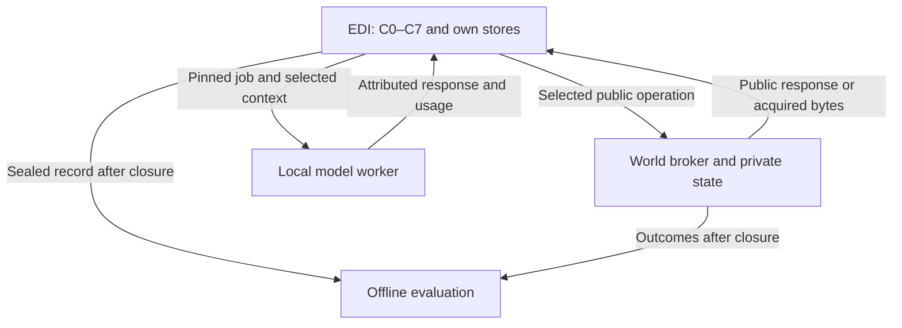

# EDI–Meadows runtime connection and first-test plan

Plan v0.1, 21 October 2026. Status: planning complete; concrete adapter contracts require implementation review; runtime and scientific verification NOT RUN. This is an operator-only supplement to the frozen development package, not participant material. No test or inference is authorized by this document alone.

## 1. The exact system under test

Use **EDI v0.9.0**, repository `vighneshcandassamy-hub/edi-systems-foundation`, implementation branch `architecture/implementation-tradeoffs-20261020`, commit **`879452b8332a318ca76af4f84589b676b031f253`**. The code exists under `src/edi/`; `pyproject.toml` exposes `edi = edi.cli:main`. Its C0–C7 source and bounded integration workflow are the implementation baseline. Its README/readiness explicitly distinguish saved source from demonstrated execution. Do not infer the implementation's absence from the older README on main.

Use benchmark package **EDI-MEADOWS-CW-DEV-0.2.1** on main at **`0827e05b2ff2d16ee6803067827a7ac83de6d069`**, with world v0.2 implementation commit **`f041a89e7b955b8135d47ee41185acac2a363c77`** and its existing BUILD_PIN. The benchmark's [testing handoff](../TESTING_HANDOFF.md) is the planning checklist. The implementation's [integration readiness](https://github.com/vighneshcandassamy-hub/edi-systems-foundation/blob/879452b8332a318ca76af4f84589b676b031f253/docs/implementation/INTEGRATION_READINESS.md), [C0 specification](https://github.com/vighneshcandassamy-hub/edi-systems-foundation/blob/879452b8332a318ca76af4f84589b676b031f253/docs/implementation/C0_INTEGRATED_WORKFLOW.md) and [holistic test design](https://github.com/vighneshcandassamy-hub/edi-systems-foundation/blob/879452b8332a318ca76af4f84589b676b031f253/docs/implementation/INTEGRATED_TEST_DESIGN.md) remain governing source documents.

Maintain two pinned checkouts for preparation. A later integration branch can combine the required source and benchmark assets through an explicitly reviewed diff. Do not merge draft PR #1 merely to prepare this plan. Runtime images use allowlisted content, not whole checkouts. No existing source, participant export, world equation, fixture, build pin or frozen package manifest changes in this planning increment.

| What is already present | What is needed for this benchmark |
| --- | --- |
| C0 typed native dispatch, immutable finite workflow plans, durable intents/resume | An event-driven investigation scheduler and bounded world operation bindings; the 28-step authored skeleton does not supply autonomous scheduling. |
| C1 exact-byte evidence recording and source/occurrence lineage | A broker acquisition connector, chunk reassembly and exact response/asset capture. |
| C2 UTF-8/JSON/CSV decoding, PNG/WAV metadata | Versioned general format readers and a real image-input route; metadata extraction is not perception. |
| C3 nine representation families, candidate-only component writes, versioned views | Reuse these paths. No forest ontology, explanatory graph, accepted ecological model or expected loops are preloaded. |
| C4 inquiry/jobs/frontier/outbox, `InferencePort.complete(job, episode)` | Native model dispatch, token/deadline/cost reconciliation and supported multimodal context binding. Current adapters report unavailable. |
| C5 restricted numerical analysis; candidate-exploration use | Reuse supported models only. No hidden world-code access or silent approximation of unsupported delay/cohort/hybrid/actor behavior. |
| C6 forecast/assessment records and feedback | Explicit constructed-world clock/measurement correspondence and separate forecast eligibility. |
| C7 research-readonly grants and internal dispatch | A scoped benchmark actuator extension for simulated-world operations. Current C7 rejects external action/acquisition; the connector must not bypass that decision. |

These are specific integration increments, not a proposal to rebuild EDI. All are unimplemented/unverified for this benchmark at the pinned revisions.

## 2. Runtime connection and ownership

Keep C0–C7 as logical owners within the existing EDI application; do not create a server for each concept. Add an acquisition adapter at C1, a model gateway at C4 and a simulated-world action adapter behind C7. C0 schedules typed work and correlates results. These are proposed bindings, not existing CLI commands.

| Public operation | EDI route and meaning |
| --- | --- |
| `mission` | C0 acquires the exact original brief through C1. Original objective remains versioned and authoritative. |
| `sources` | C0/C1 retrieves the ordinary directory when EDI chooses to browse. |
| `people` | C0/C1 retrieves the registered institutional roles. |
| `search` | EDI selects query/source/page; C1 captures the exact result and selection. No relevance labels or operator reranking. |
| `read` | C1 captures metadata/text and requested original byte ranges; retain source/document IDs, chunk offsets and hashes. |
| `records` | C1 captures requested pages/row selectors with lineage to the external source asset. |
| `ask` | C0 routes an EDI-selected question to a registered role through C1. The current world returns frozen source-linked material, not open-ended generated expert answers. |
| `measure` | C0 requests a C7-authorized acquisition job; C1 later captures published measurements. Record cost, due time and request/occurrence separately. |
| `act` | C0 → C7 authorization → world adapter. Schedule only supported simulated treatment/harvest within the standing mission grant; receipt is not measured effect. |
| `advance` | C0 → C7 authorization → world adapter. This changes simulation time and executes jobs; it is not a read or an invisible scheduler side effect. |
| `status` | C0/C1 retrieves public time, spending, jobs, observations and proposals. No private state projection. |
| `propose` | C0 carries an objective-change proposal with C7 authority checks. Preserve `pending_human_review`; do not replace the original objective automatically. |
| `submit` | C0 submits EDI's conclusion/recommendations/uncertainty and acquired citations under the finalization grant. Close exactly once and retain the receipt. |

Transport stays **POST `/v2/<operation>` at `127.0.0.1:8766`**, bearer authenticated, using the frozen public shapes and limits. No wrapper requirement for a hypothesis/rationale is added to a world call. EDI's existing internal reasoning records and selected protocol remain its own mechanisms; they are not benchmark hints. The scheduler may translate an EDI-selected test into typed arguments but may not choose the ecological hypothesis, query, metric, stand, treatment or conclusion for it.

**Proposed scheduler contract.** Persist a root investigation with immutable mission, standing operation grants, acquired-source index, current C3 revision, pending jobs, budget and continuation links. Wake on a new C1 occurrence, model response, public job completion or explicit resume. Select a bounded current cut, create a C4 inquiry, dispatch its job, validate/import the actual response, retain candidates/frontier and schedule supported selected work through C0. End, yield or request access explicitly. Each new inquiry preserves prior references while taking a fresh cut; do not rewrite an earlier episode to add later evidence. Current C4 bounds remain two student rounds, three rivals per round, four jobs and one unresolved exported job per workspace. Multiple linked inquiries permit continuation without increasing these caps silently.

The existing outbox carries free-text test/frontier proposals, not an executable 13-tool request union. Define a new strict operation-intent envelope with allowlisted operation/arguments, originating episode/artifact sequence and request identity. Use a separately attributed model job to produce typed arguments when needed; count its cost and validate both schema and authority. No guessed intent execution or arbitrary method/shell dispatch. Syntax validation may return the actual error; it must not inject an ecological correction.

**Admission and authority.** C2/C4/C6 proposals remain candidates. C3 queries can return candidates, and C5 supports explicit `candidate-exploration`; neither requires a human to bless the ecological explanation on every iteration. Keep C3 promotion/operator decisions separate. No model-generated input can invoke `world-commit`, policy adoption or operator reconciliation. The initial C7 standing policy is adopted once by the isolated test operator from the human mission, without solution content. Its new benchmark grant covers only the pinned simulated session and finite public operations. Objective amendments require a distinct human decision; record a pause if one becomes necessary. This is an implementation contract to add and review, not an already-installed C7 permission.

**Evidence and effects.** C1 owns acquired bytes/receipts; C2 owns derived views; C3 owns interpretations; C4 owns proposals/selections; C5 owns conditional analyses; C6 owns prospective expectations/assessments; C7 owns authorization/dispatch; C0 owns coordination. The world broker is sole authority for simulated state, jobs and budget. EDI stores a public projection only. Teacher output, generated summaries and C5 trajectories cannot corroborate themselves. The operator evaluator is never an online teacher.

**Delivery and restart.** Before I/O, persist run/session/operation/request ID and exact canonical body digest. A timeout retries only that original request/body; the broker returns its committed response. A changed body needs a new identity. Do not promise a distributed transaction across broker, connector and C1: reconcile a crash after broker commit by replaying the original request, then idempotently commit the same C1 acquisition occurrence before acknowledging C0. Keep separate fetch occurrences even if payload hashes match. C0's uncertain native step is not automatically replayed; establish the old worker has stopped, inspect the corresponding owner/job status and reconcile through the trusted control channel. Model invocation has its own uncertain cost record; do not assume the HTTP server deduplicates inference.

## 3. Model and heterogeneous information

**Proposed first student: `Qwen/Qwen3-VL-8B-Instruct`, fixed weights, local vLLM.** It is a pretrained instruction vision-language model with image/video routes documented by its publisher; vLLM lists the architecture. This fits the saved initial pretrained-student direction and permits testing heat maps/images once EDI's image binding exists. It is an engineering candidate, not a claim that it is the best current model or that EDI has already used it.

For the first pilot use one student backend, temperature 0, seed 17, one concurrent inference, proposed 16,384 total model tokens, at most 12,288 input and 4,096 output tokens per job. Count image tokens and the entire rendered prompt. No hidden truncation. Reduce the selected cut or defer when it does not fit; retain omissions. Cap image expansion at two images/job and a processor-enforced pixel limit to be frozen with the checkpoint. Temperature/seed do not guarantee bitwise reproducibility.

Teacher dispatch is **disabled for the first diagnostic pilot** and its status is reported. This isolates the first connection and bounds hardware/cost. The saved selective-teacher design remains available for a separately pinned follow-up; that configuration must identify its checkpoint/provider and cannot acquire extra evidence or act. A student-only pilot does not qualify teacher integration or represent the entire future architecture. No weights are trained, fine-tuned or updated on the target world or operator audit.

Before launch pin the exact checkpoint commit, every weight/config/tokenizer/processor hash, chat template, vLLM/container digest, Python/CUDA/driver versions, precision, decoding settings and hardware. The planning configuration intentionally leaves unresolved pins null and is **not launchable**. Recommended preparation profile: an existing Linux GPU host with about 48 GB VRAM, 32 GB host RAM and 60 GB free disk. These are provisional capacity allowances, not measured requirements or confirmed available resources. Qualify actual fit/throughput on neutral data; no automatic model downgrade, quantization, remote API or paid provisioning. Any such change gets a new run configuration.

| Information | First-test handling and honest limit |
| --- | --- |
| Text/logs/JSON/CSV and numeric rows | Native bytes retained; use existing C2 readers and explicit units/time/missingness. JSONL/XML/HTML and spreadsheets need versioned bounded readers rather than an assumption that file extension implies understanding. |
| PNG/JPEG/heat maps | A required new C4 multimodal context binding references acquired C1 bytes, exact selectors, image digests and processor settings in the job hash. Send actual image tensors/parts to the model. Current PNG metadata and C4 binary metadata-only excerpts do not satisfy this. |
| PDF | Retain original; use a pinned general text extractor and/or page rasterizer, with exact page/region lineage and charged work. No operator-authored interpretation. |
| SVG/GIF/video | Retain original. Generic versioned rendering/frame extraction may produce image views with timestamps and explicit sampling loss. Video temporal understanding requires its own tested route; a few frames do not establish it. |
| WAV | Current C2 exposes headers only. Preserve native waveform; mark semantic audio interpretation unavailable in this first profile unless a separately qualified waveform/audio worker is added. Do not assume the chosen VL checkpoint provides audio understanding. |
| NPZ/GeoJSON/other unsupported assets | Preserve bytes; add only bounded general readers with array/feature selectors and provenance. Unavailable decoding is an observed capability limit, not invented content. |

Every source remains available through the world; EDI chooses what to acquire. The first pilot qualifies only the declared supported views. Native image transport is a launch prerequisite for calling this an image-inclusive pilot. A text-only engineering run can be labeled separately and cannot stand in for multimodal qualification. Derived formats sharing one source are dependent views, not additional independent field evidence. The external modern corpus and the constructed district are different origins; the adapter must not fabricate a geographic/time identity match.

## 4. Isolation and execution location

Propose an existing Linux host with three containers: **world**, **EDI**, **model**. Evaluation runs offline after closure. Do not upload owner files into the participant's notebook/process. Host availability and actual isolation are unverified; no infrastructure is provisioned by this plan.

The broker binds loopback, so ordinary separate bridge containers cannot reach it directly. Keep that binding: start the world container with `--network none`; EDI and model join its network namespace using `--network container:<world>`. Docker documents this loopback-sharing mode. Separate mount and PID namespaces remain essential; sharing a network stack does not justify sharing files or processes. Only the broker and inference service listen in that namespace; no published ports, host networking, DNS egress or extra attached networks. Model listens on its own loopback port 8000. Prestage images/weights/dependencies before disconnecting the network. Recreating the world container requires reattaching the other containers and reconciling the session; restart is not an unnoticed world reset.

| Surface | Allowed | Excluded |
| --- | --- | --- |
| World | Pinned broker/world/corpus/assets, private run database, scoped bearer secret | EDI writes to private world files; online evaluator output. |
| EDI | Allowlisted runtime code/schemas, four participant files, its eight owner stores, acquired bytes, neutral profiles and scoped session secret | Whole repository, source history, benchmark name/audit, private initial/future state, equations, evaluator, hidden labels, host home, GitHub credentials, Docker socket. |
| Model | Pinned weights/processor, selected job/context, bounded logs | World files, owner repository, operator files, bearer secret, arbitrary file/URL loading, independent tool or shell access. |
| Operator/evaluator | Private retained run archives after stopping inference | Any route feeding outcomes/expected explanation back during investigation. |

Use non-root users, read-only application files, dedicated writable volumes, dropped capabilities, no-new-privileges, finite CPU/RAM/PID/tmpfs/disk/log quotas and separate process namespaces. Model processes GPU resources only; do not use host IPC/PID mounts as a shortcut. Bound decoder execution too. The trusted EDI SDK is not an authentication boundary: untrusted source/model JSON never becomes Python execution or an operator API call. These controls target inadvertent benchmark leakage and model-output misuse on a single trusted host; they are not a claim of resistance to a malicious host administrator or container escape.

Before running, test isolation from the EDI container: known owner/audit/state canary paths are unreadable; model has no token; host processes/environment and Docker socket are unavailable; outside HTTP/DNS is blocked; broker rejects missing/wrong credentials and private paths; only the public response schema arrives; all staged files match the allowlist. Capture mount/process/network inspections and negative-probe results. A failed leakage check blocks the pilot. The existing participant ZIP allowlist is necessary but insufficient to prove deployment isolation.

## 5. Initial presentation and first executions

Initial EDI case material is exactly the frozen `mission.json`, generic `PUBLIC_OPERATIONS.json`, `PARTICIPANT.md` and transport client. Deliver no curated source subset, suggested first question, feedback diagram, historical resolution, reference explanation, policy menu or audit. The runtime's pre-existing generic systems protocol is separately versioned and attributed. Start with empty case memory; pretrained knowledge is still a prior. Do not expose this operator plan or repository paths to the model. No new ecological prompt is authored in this plan.

Separate two future executions:

1. **T0 engineering readiness:** instantiate the implementation's P1 neutral accumulator handoff in a disposable workspace, with explicit authored setup/operator decisions and independent later measurements. Freeze its clock/tolerance/refusals first. Exercise model dispatch, acquired bytes, candidate writes, supported analysis, forecast/measurement correspondence, action denial and restart; include a neutral image transport check. This checks plumbing, not forest discovery. Do not run it while authoring this plan.
2. **T1 first benchmark pilot:** one fresh Cedar District session at year 0, fixed fixture seed **7021**, original objective and all 13 public operations. The broker has no seed CLI override; use the pinned initial state unchanged. EDI chooses inquiries, evidence, representations, hypotheses, supported analyses, measurements, actions, time advances and conclusion. The operator does not prescribe a tool sequence or require every operation. An uncertainty-qualified report without intervention is permissible. Every unsupported request remains explicit. This is a development investigation, not a held-out comparison or demonstration of superiority.

T1 proposed resource envelope: 60 minutes active wall time per resumable session, 262,144 aggregate model input/output tokens including helpers/teacher if later enabled, at most 32 linked C4 inquiries, one outstanding model invocation, 300 new public-operation requests and 1 GiB newly acquired bytes. These are engineering guardrails, not solution-quality thresholds. Token/job reservations also obey the stricter existing per-inquiry caps. Heartbeat every 60 seconds; checkpoint after each durable model/tool result. Check quota before new work. On a limit, preserve state and yield for review; label the investigation incomplete, not failed reasoning. No silent budget extension. Physical world limits remain 240 units/year, year 50 maximum, advance 1–5 years, 100 pending jobs, and the public paging/chunk bounds.

Three consecutive equivalent requests with unchanged relevant evidence/time/state trigger a non-progress yield and diagnostic. Do not treat a valid retry after a lost receipt, or waiting for a future measurement, as repeated reasoning failure. One schema-repair attempt may receive the exact validation error with unchanged case evidence; it consumes budget and cannot supply content answers. Model/transport timeout, parser refusal, unsupported dynamics, lack of identifying evidence and substantive mistaken conclusions are reported as different failure categories.

**Clock and forecast contract.** Reading does not advance world time. Preserve simulation year, source event year where supplied, wall-clock receipt/commit and known-at cut separately. Publish due measurements only after the chosen `advance`; identify work-before-measurement ordering. C6 currently expects its exact measurement schema and temporal semantics: define a monotonic, explicitly synthetic year-to-UTC mapping before use, retaining original year and receipt time. Label broker measurements as observations of a constructed world, not empirical forest measurements. Verify C6 origin/eligibility explicitly. If its existing guard rejects simulation-origin evidence, retain an unscored prospective record or implement/review a dedicated constructed-world assessment profile; never relabel generated data to pass an empirical seal. Freeze any quantitative forecast before advancement and distinguish it from a retrospective explanation. Quantitative forecasts are not mandatory to obtain tool access.

On `submit`, preserve original conclusion/citations/uncertainties and closure receipt, then stop inference and seal artifacts. If the run yields or fails first, retain it as incomplete without manufacturing a final submission. Objective proposals remain pending human review; human feedback, if supplied, creates an attributed event and a new continuation cut. No investigator coaching is allowed.

## 6. What to record and how to judge the pilot

Keep source/world/adapter/config/model/container pins, exact initial material, standing authority, source registry, all request/response bodies and IDs, selection history, acquired original bytes and hashes, derived-view procedures/selectors, model rendered inputs/outputs and usage, C3 versions/candidate histories, C4 episodes/frontiers, C5 runs, C6 expectations/cuts, C7 decisions/receipts, time advances, start/pause/resume/cancel/failure events and final report. Record structured public rationale summaries and native artifacts; do not require hidden chain-of-thought. Store secrets/private session databases outside Git. Publication of results is a separate decision.

Measure the whole path: all inference/helper/repair/failed tokens, parsing/rasterization/retrieval, queue and wall time, world-operation costs, transfer, storage/checkpoint overhead and actual compute/energy when instrumented. Missing usage stays unknown; model labels, reserved tokens, GPU TDP or token count are not measured energy. Physical world budget and compute budget are separate ledgers.

Judge T0 on the prospective [verification cases](VERIFICATION_CASES.json). T1 engineering integrity requires no critical leakage, authority escalation, duplicate side effect, lost acknowledged evidence or generated-evidence promotion. A normal exit does not suffice. Inspect whether actual EDI state and revisions were consumed by later inquiry/selection; a model plus tools behind an unused EDI shell is not an integrated EDI result.

Assess investigation usefulness separately: evidence-supported claims versus unsupported claims, source dependence/noise handling, useful discriminatory requests, retained alternatives, uncertainty and nonidentifiability, effects/constraints across horizons, and proposed objective changes. Do not reward graph size, question count, treatment volume or agreement with a supplied story. After closure run the existing offline evaluator and report its outcome vector (damage, spending, delivery shortfall, treatment dose, terminal foliage/enemies) with horizon and opportunity limits. It is not a scalar optimum or a complete intelligence score. Historical human reasoning is a private reference for mechanism review, not a string-match answer key. This constructed simulation cannot establish historical/ecological validity.

Later comparisons require fresh matched worlds, frozen instance/seed sets, model/tools/authority/teacher/information/budget parity, competent ordinary-history/retrieval/structured-memory baselines, preregistered endpoints and uncertainty/power decisions. New seeds/instances require separately versioned fixtures; they are not supported by an invented broker option. Preserve this pilot as development data. Do not derive significance or EDI advantage from one session, or retrofit a held-out claim after inspecting it. A pretrained model may already know the published budworm story; concealing operator files does not erase that knowledge. Mechanism use must be grounded in acquired evidence and later counterfactual variants before claiming discovery or transfer.

## 7. Implementation order and launch gates

| Order | Concrete deliverable | Gate to close |
| --- | --- | --- |
| A | Pin both source lines and review a combined integration checkout; source-only compatibility/install/schema audit | Exact artifacts and dependency resolution; no source branch substituted or silently merged. |
| B | Strict broker connector/C1 capture, public identity/time mapping and recovery journal | All 13 operations mapped; chunks/pages/hashes and lost receipts handled; no private endpoint. |
| C | C4 inference gateway and native image binding with pinned Qwen/vLLM environment | Real model responses and usage bound to job/context; actual image part checked on neutral fixture. |
| D | C0 dynamic scheduler/typed intents and C7 scoped simulated-world authority | EDI-selected next work; no fixed forest workflow, arbitrary dispatch or privilege bypass. |
| E | C6 constructed-world correspondence, modality support manifest and complete run accounting | No forged empirical outcomes; unsupported views/dynamics remain explicit. |
| F | Three-container packaging, allowlists, finite profiles and operator control separation | Isolation probes and restore/reconciliation pass at pinned config. |
| G | Freeze T0 fixture/cases; execute it only after owner directs execution; repair observed defects | Scoped engineering readiness with original failures retained. |
| H | Freeze T1 complete manifest, reset case memory/new world, then later run the unguided pilot | All required gates passed, exact pins present and execution explicitly directed. |

Plan decisions are recorded in [RUN_CONFIG.proposed.json](RUN_CONFIG.proposed.json), [SOURCE_PINS.json](SOURCE_PINS.json), [TRACEABILITY.json](TRACEABILITY.json), [INTERFACE_REVIEW.json](INTERFACE_REVIEW.json) and [COMPONENT_REVIEW.json](COMPONENT_REVIEW.json). These are design artifacts, not execution evidence. Component/interface review is a self-review using the repository skills. Contract readiness remains **REVISE** until exact new schemas, C7 grants, scheduler decisions and C6 eligibility are reviewed; runtime/integration are **BLOCKED / NOT RUN**. The next authorized planning result is concrete implementation work packages, not a claim that the benchmark has started.

Primary technical references checked 21 October 2026: [publisher model card](https://huggingface.co/Qwen/Qwen3-VL-8B-Instruct), [vLLM v0.21.0 model support](https://docs.vllm.ai/en/v0.21.0/models/supported_models/) (support reference, not a frozen serving build), [Docker networking](https://docs.docker.com/engine/network/) and [none driver](https://docs.docker.com/engine/network/drivers/none/). Recheck and pin actual package/container compatibility during implementation.
